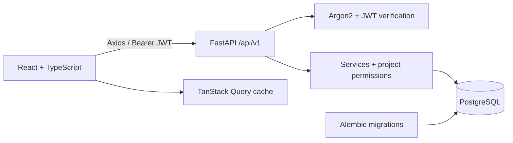

# Architecture

TaskFlow is a modular monolith: synchronous FastAPI routes delegate mutations to services; services enforce project permissions and use one SQLAlchemy transaction per request. PostgreSQL is the application and integration-test database.



## Data and permissions

- Users own projects. Each project has exactly one owner membership created in the same transaction as its project. A partial unique index prevents multiple owners; ownership changes are absent from the public API.
- Owners manage project deletion and admins. Admins manage project details, regular members, and all tasks. Members create tasks and edit/delete their own. Assignees may change only status unless another permission applies.
- Resource reads check membership; nested task routes also verify the task's project ID. Inaccessible resources return 404.
- Project mutations acquire the project row lock before membership checks. This serializes member removal, task assignment and related writes. Removing a member clears their assignments within the same transaction.
- Project deletion cascades through memberships and tasks. User deletion and ownership transfer are outside v1.
- Timestamps are stored with time zone in PostgreSQL; incoming deadlines require a time zone. The UI converts local date/time input to UTC and displays dates locally.

## HTTP contracts

Reads return resources directly. Lists return `{items, page, page_size, total}` with a maximum page size of 100. Mutations return `{code, message, data}`. Errors return the same envelope, plus safe field locations on validation failures. Raw inputs, password hashes and database errors are never included.

Language selection is request-local: `lang` query parameter, weighted supported `Accept-Language` value, authenticated user's saved preference, English. Unsupported explicit query languages use English. User content and enum values remain unchanged.

## Session and deployment

Access tokens expire after 30 minutes by default and exist only in JavaScript memory. Reloading or expiry requires login. HTTP 401 clears the cache and session. Language and theme alone use local storage.

Production Compose serves a built React bundle through Nginx with an API reverse proxy. The database and API have no public ports. Place an HTTPS reverse proxy in front of the loopback-bound port 8080. Supply unique secrets using environment configuration. The v1 template has no public account recovery, email verification, rate limiting, or refresh tokens; assess these before an unrestricted public deployment.

## Repository

```text
backend/
  app/{core,db,models,schemas,routers,services,i18n}/
  alembic/versions/0001_initial.py
  tests/                     PostgreSQL API integration tests
  pyproject.toml             Python dependencies and lint configuration
frontend/
  src/{api,components,contexts,locales,pages,types,utils}/
  tests/e2e/                 Playwright real-API smoke tests
  Dockerfile                 Development and production targets
docs/                        Architecture, API and verification notes
screenshots/                 Real application screenshots
.github/workflows/ci.yml      Backend, frontend and Compose smoke jobs
docker-compose.yml           Local development
docker-compose.prod.yml      Production build and private database
```
